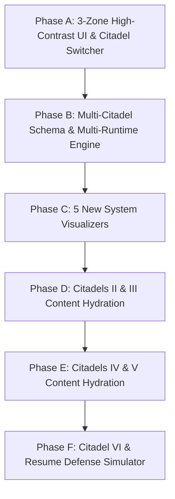

# PatternForge Engineering Citadel: Master System Design & Curriculum Plan

This document serves as the **Principal Engineering Specification** for evolving **PatternForge** from a single-track DSA application into a **6-Citadel Full-Stack, Backend & AI Interview Mastery Platform**.

It is designed around a **Basement-to-Roof (Brick-by-Brick) Dependency Engine**, hands-on practical coding sandboxes (Python, OOP, Pandas, File Parsing, SQL, Async/Concurrency, FastAPI), interactive visual simulators, and a **3-Zone High-Contrast UI Architecture**.

---

## 1. Core Architectural Philosophy: The "Basement-to-Roof" Engine

Standard interview prep fails because candidates study "Roof" concepts (like Python's `asyncio` vs. `multiprocessing`, SQL `DENSE_RANK()`, or B-Tree indexing) as isolated trivia without building the "Basement" mental models first. When an interviewer asks a second-level follow-up question, memorized definitions collapse.

Every topic across the platform enforces a strict **4-Layer Brick Hierarchy**:

```
┌────────────────────────────────────────────────────────────────────────────┐
│ LAYER 4: THE ROOF TERRACE (Live Practical Coding & Interview Defense)     │
│ Real working code (SQL queries, Pandas pipelines, OOP classes, async       │
│ workers, FastAPI middleware) + Crisp 60-second Senior Engineer pitch.      │
├────────────────────────────────────────────────────────────────────────────┤
│ LAYER 3: THE WALLS (Applied Patterns & Trade-Offs)                         │
│ Pattern A vs. Pattern B, why Brute Force fails, production failure modes.  │
├────────────────────────────────────────────────────────────────────────────┤
│ LAYER 2: THE FOUNDATION (Core Primitives & Mechanics)                      │
│ Process vs. Thread, Heap Page vs. B-Tree Node, Object vs. Blueprint.       │
├────────────────────────────────────────────────────────────────────────────┤
│ LAYER 1: THE BASEMENT (Hardware / Memory / Disk / Protocol Reality)        │
│ How CPU, OS kernel, disk page, or network socket physically handles data.  │
└────────────────────────────────────────────────────────────────────────────┘
```

- **Layer 1: The Basement (Hardware / Memory / Disk / Protocol Reality):** How the computer, OS kernel, disk page, or network socket physically handles the data.
- **Layer 2: The Foundation (Core Primitives & Mechanics):** The fundamental building blocks (e.g., Process vs. Thread, Heap Page vs. B-Tree Node, Object Reference vs. Class Blueprint).
- **Layer 3: The Walls (Applied Patterns & Trade-Offs):** When to use Pattern A over Pattern B, why Brute Force fails, and what edge cases break production systems.
- **Layer 4: The Roof Terrace (Live Practical Coding & Interview Defense):** Writing real working code (SQL queries, Pandas pipelines, OOP classes, async workers, FastAPI middleware) and delivering a crisp 60-second Senior Engineer spoken explanation.

### Strict Unlocking Rule
Just as Stage 1 unlocks Stage 2 inside a lesson, **Brick $N$ is locked until Brick $N-1$ is completed and verified**. You cannot attempt the Multiprocessing vs. Asyncio coding lab until you have cleared the `CPU Core` $\rightarrow$ `OS Process` $\rightarrow$ `Thread` $\rightarrow$ `GIL` bricks.

---

## 2. Multi-Citadel Information Architecture & Routing

To preserve 100% of the working codebase already built (`Dashboard.tsx`, `WorldPage.tsx`, `QuestionPage.tsx`, `Playground.tsx`, `Grimoire`, and the 115 validated YAML lessons), the platform introduces a top-level **Citadel Switcher** while reusing the exact same Constellation Map, Stepping-Stone Trail, and 4-Stage Workspace engine.

### 2.1 The 6 Citadels (Realms)

1. **Citadel I: DSA Pattern Forge**
   - Existing 12 Worlds, 115 Questions — preserved intact.
2. **Citadel II: Practical Python, OOP, Design Patterns & Data Engineering Lab**
   - Objects/Memory $\rightarrow$ Decorators/Generators $\rightarrow$ OOP & SOLID $\rightarrow$ PDF/XML/JSON/CSV File Handling $\rightarrow$ Pandas DataFrames.
3. **Citadel III: SQL Mastery & Database Internals (DBMS)**
   - Disk Pages & Table Scans $\rightarrow$ B-Tree/Hash/Composite Indexes $\rightarrow$ 25 Classic SQL Interview Queries $\rightarrow$ Triggers, ACID, Normalization & SQLAlchemy ORM.
4. **Citadel IV: OS, Concurrency, Parallelism & Async Execution**
   - CPU & Processes $\rightarrow$ Threads & Race Conditions $\rightarrow$ Concurrency vs. Parallelism $\rightarrow$ Python GIL $\rightarrow$ Asyncio, ThreadPool & ProcessPool Coding.
5. **Citadel V: Backend Systems, FastAPI, HTTP Lifecycle & Auth**
   - HTTP Envelope $\rightarrow$ 4xx/5xx Status Codes $\rightarrow$ Auth, JWT, OAuth2 & CORS $\rightarrow$ FastAPI File Uploads, Validation & Redis/Celery Queues.
6. **Citadel VI: GenAI / LLM Architecture & Resume Defense Simulator**
   - Embeddings & Vector DBs $\rightarrow$ Production RAG $\rightarrow$ Genetic Prompt Optimization & Agents $\rightarrow$ Bullet-by-Bullet Live Defense of Suhas's Resume.

### 2.2 Upgraded URL & Route Structure

- `/` or `/citadel/:citadelId` — Renders the Dashboard (Current Quest, Mastery Ticker, Rust Radar, and the Constellation Skill-Tree scoped to the currently active Citadel).
- `/world/:worldId` — Renders the Winding Stepping-Stone Trail (Basement Bricks $\rightarrow$ Foundation Bricks $\rightarrow$ Wall Bricks $\rightarrow$ Roof Boss Node) for that specific module.
- `/q/:slug` — Renders the 4-Stage Learning Workspace, dynamically loading the right Editor language (`python`, `sql`, `java`) and the matching Visualizer Engine for that Citadel.
- `/resume-grill` — Dedicated interactive simulator that maps every project and experience bullet from your resume to deep-dive technical grill cards and live coding proofs.
- `/playground` — Expanded with presets not only for DSA, but also for live SQL Sandbox tables, Pandas DataFrames, and Concurrency Timelines.

---

## 3. Complete "Basement-to-Roof" Curriculum Specification

Below is the exact brick-by-brick progression across Citadels II through VI (with Citadel I retaining all 12 DSA worlds and 115 lessons).

```
CITADEL PROGRESSION OVERVIEW:
Citadel I   : DSA Pattern Forge (12 Worlds, 115 Lessons)
Citadel II  : Practical Python, OOP, Design Patterns & Data Lab (27 Bricks across 4 Worlds)
Citadel III : SQL Mastery & Database Internals (DBMS) (28 Bricks across 2 Worlds)
Citadel IV  : OS, Concurrency, Parallelism & Async Execution (8 Bricks across 1 World)
Citadel V   : Backend Systems, FastAPI, HTTP Lifecycle & Auth (8 Bricks across 1 World)
Citadel VI  : GenAI / LLM Systems & Resume Defense Simulator (6 Bricks across 1 World + 10 Grill Drills)
```

---

### CITADEL II: Practical Python, OOP, Design Patterns & Data Lab

Designed to prepare you for practical Python coding rounds where interviewers ask you to design clean classes, parse messy files (PDF/XML/JSON/CSV), or manipulate data with Pandas.

#### World C2-W1: Python Internals, Memory & Pythonic Mechanics (6 Bricks)

- **Brick 1 (Basement): Stack References vs. Heap Objects & Mutability Traps**
  - *Concept:* How Python variables are pointers to `PyObject`s on the heap; why `def append_item(item, target=[]):` causes catastrophic state bugs across function calls; `is` vs. `==`; shallow copy vs. `copy.deepcopy()`.
  - *Practical Coding Task:* Fix a buggy stateful request logger suffering from shared mutable default arguments and shallow-copied nested dicts.
- **Brick 2 (Foundation): Iterators, Generators (`yield`) & Memory-Safe Streaming**
  - *Concept:* Why loading a 5GB log file with `.readlines()` triggers an Out-Of-Memory (OOM) crash, and how `yield` pauses function stack frames in $O(1)$ memory.
  - *Practical Coding Task:* Write a lazy generator pipeline that streams a massive server log, filters 500 errors, and yields parsed JSON records batch-by-batch.
- **Brick 3 (Foundation): Context Managers (`with`, `__enter__`, `__exit__`) & Resource Safety**
  - *Concept:* How file descriptors, DB connections, and thread locks leak when exceptions occur, and how context managers guarantee deterministic cleanup.
  - *Practical Coding Task:* Implement a custom `DatabaseTransaction` and `TempFileHandler` context manager using both class-based (`__enter__`/`__exit__`) and `@contextlib.contextmanager` patterns.
- **Brick 4 (Walls): Closures, `*args`/`**kwargs` & Custom Function Decorators**
  - *Concept:* First-class functions, lexical closures, `functools.wraps`, and wrapping behavior around arbitrary functions.
  - *Practical Coding Task:* Code an adaptive `@retry(max_attempts=3, backoff=2, exceptions=(TimeoutError,))` decorator and a `@track_token_cost` decorator (directly mirroring your FitLabs adaptive retry logic and GEPA token budget controls).
- **Brick 5 (Walls): Metaclasses, `__new__` vs `__init__`, and Attribute Lookup (`__getattr__` vs `__getattribute__`)**
  - *Concept:* Object instantiation lifecycle, dynamic attribute delegation, and intercepting attribute access.
- **Brick 6 (Roof): Building a Production Type-Safe Config Loader**
  - *Concept & Task:* Combine descriptors, type hints, and context managers to build a robust configuration validator.

#### World C2-W2: Object-Oriented Programming (OOP), SOLID & Design Patterns (8 Bricks)

- **Brick 1 (Basement): Classes, Instance vs. Class State, and Method Binding**
  - *Concept:* How `self` and `cls` work under the hood; instance attributes vs. shared class attributes; `@classmethod` (alternative constructors) vs. `@staticmethod`.
  - *Practical Coding Task:* Build a `PromptTemplate` class with `.from_json()` and `.from_yaml()` `@classmethod` constructors and instance validation.
- **Brick 2 (Foundation): Python Dunder (Magic) Methods & Operator Overloading**
  - *Concept:* Making custom objects behave like native Python types using `__init__`, `__repr__`, `__str__`, `__eq__`, `__lt__`, `__hash__`, `__len__`, `__getitem__`, and `__call__`.
  - *Practical Coding Task:* Implement an executable `PromptEvaluator` class using `__call__` and comparable `BenchmarkResult` objects supporting sorting and set deduplication.
- **Brick 3 (Foundation): The 4 Pillars of OOP (Encapsulation, Inheritance, Polymorphism, Abstraction)**
  - *Concept:* Protected (`_x`) vs. name-mangled (`__x`) attributes, `@property` getters/setters, Method Resolution Order (MRO) with `super()`, and enforcing strict contracts with `abc.ABC` and `@abstractmethod`.
  - *Practical Coding Task:* Build an abstract `BaseDocumentParser(ABC)` and concrete `PDFParser`, `DOCXParser`, and `XMLParser` subclasses (mirroring your WisdomBot and Drizz pipelines).
- **Brick 4 (Walls): SOLID Principles in Production Python**
  - *Concept:* Single Responsibility (SRP), Open/Closed (OCP), Liskov Substitution (LSP), Interface Segregation (ISP), and Dependency Inversion (DIP) shown via "Bad Spaghetti Code $\rightarrow$ Clean Refactored Code."
  - *Practical Coding Task:* Refactor a monolithic `LLMRunner` class containing hardcoded `if provider == "openai": elif provider == "claude":` blocks into SOLID-compliant components.
- **Brick 5 (Roof): Creational Patterns — Factory & Singleton**
  - *Concept:* When and how to implement a Thread-Safe Singleton (e.g., DB Connection Pool / Config Manager) and the Factory Pattern for instantiating objects dynamically.
  - *Practical Coding Task:* Code the exact `LLMProviderFactory` from your Drizz resume bullet that dynamically instantiates `OpenAIClient`, `ClaudeClient`, or `GeminiClient` from config strings.
- **Brick 6 (Roof): Behavioral & Structural Patterns — Strategy, Adapter & Observer**
  - *Concept:* Swapping algorithms at runtime (Strategy), normalizing incompatible third-party APIs (Adapter), and event-driven callbacks (Observer).
  - *Practical Coding Task:* Implement a pluggable Genetic Mutation Strategy (`CrossoverStrategy`, `MutationStrategy`, `ElitismStrategy`) for your GEPA Prompt Optimizer framework.
- **Brick 7 (Roof): Structural Patterns — Decorator & Composite Pattern**
  - *Concept:* Dynamic behavior augmentation and tree-structured component hierarchies.
- **Brick 8 (Roof Boss): End-to-End Modular Pipeline Engine**
  - *Practical Coding Task:* Architect an extensible document extraction and transformation pipeline honoring all SOLID principles.

#### World C2-W3: Practical File Handling — PDF, XML, JSON & CSV Pipelines (6 Bricks)

- **Brick 1 (Basement): File Streams, Character Encodings (UTF-8), and `io.BytesIO`**
  - *Concept:* Text mode (`"r"`) vs. binary mode (`"rb"`), handling corrupted byte sequences, and processing uploaded files in memory with `io.BytesIO` without touching disk.
- **Brick 2 (Foundation): Deep JSON & NDJSON Parsing, Validation & Flattening**
  - *Concept:* Navigating deeply nested API responses safely, flattening nested dictionaries, and streaming newline-delimited JSON (`.jsonl`).
  - *Practical Coding Task:* Parse a nested multi-provider LLM benchmark JSON payload, extract token counts, latency, and error traces, and flatten it into normalized records.
- **Brick 3 (Walls): XML DOM Tree Parsing & Active Sibling Pruning**
  - *Concept:* Using `xml.etree.ElementTree`, traversing parent/child/sibling nodes, bounding-box coordinates, and Lowest Common Ancestor (LCA) tree reduction.
  - *Practical Coding Task:* Code a working version of your Drizz Active-Based Sibling Pruning algorithm that takes a bloated mobile UI XML tree + OCR bounding boxes and prunes redundant un-interactive sibling nodes to shrink token count by 67%!
- **Brick 4 (Roof): PDF & Document Text Extraction, Cleaning & Semantic Chunking**
  - *Concept:* How PDFs store text boxes (not paragraphs), stripping headers/footers/artifacts, and sliding-window text chunking with token overlap for RAG.
  - *Practical Coding Task:* Write a document ingestion pipeline that reads raw multi-page PDF extracted text, cleans hyphenated line breaks, splits by semantic section headers with configurable overlap, and attaches page-number metadata (your WisdomBot pipeline).
- **Brick 5 (Roof): High-Performance CSV Streaming & Dialect Handling**
  - *Concept:* Parsing irregular CSV delimiters, escaped quotes, and large-file streaming with `csv.DictReader`.
- **Brick 6 (Roof Boss): Multi-Format Ingestion Engine**
  - *Practical Coding Task:* Build a unified document converter routing PDF, XML, JSON, and CSV into standard RAG text documents.

#### World C2-W4: Practical Pandas & Data Engineering Coding Arena (7 Bricks)

- **Brick 1 (Basement): Series vs. DataFrame Internals & Vectorization**
  - *Concept:* Why looping over a DataFrame with `for row in df.iterrows():` is 100x slower than vectorized NumPy/Pandas column operations; inspecting schemas with `.info()`, `.describe()`, and `.dtypes`.
- **Brick 2 (Foundation): Precision Indexing (`.loc` vs. `.iloc`) & Complex Boolean Filtering**
  - *Concept:* Label-based vs. positional slicing, multi-condition masks (`&`, `|`, `~`, `.isin()`, `.str.contains()`), and avoiding `SettingWithCopyWarning`.
  - *Practical Coding Task:* Filter a 10,000-row dataset of mobile UI test runs to isolate failed tap/swipe actions on Android where latency exceeded 500ms.
- **Brick 3 (Foundation): Cleaning Messy Data (NaN, Duplicates, Type Casting & Outliers)**
  - *Concept:* Detecting missing values (`.isna()`), targeted imputation (`.fillna()` with median/group-mean), `.dropna()`, `.drop_duplicates(subset=..., keep='last')`, and parsing dirty timestamp/currency strings.
  - *Practical Coding Task:* Clean a corrupted CSV dump of e-commerce garment orders and user telemetry before feeding it into an analytics dashboard.
- **Brick 4 (Walls): GroupBy, Multi-Metric Aggregations (`agg`) & Pivot Tables**
  - *Concept:* Split-Apply-Combine mental model; computing simultaneous count, mean, median, and custom p95 percentiles per group using `.groupby().agg()`.
  - *Practical Coding Task:* Compute an A/B testing benchmark leaderboard from raw LLM execution logs, calculating success rate %, average latency, and total USD token cost grouped by `model_name` and `prompt_variant`.
- **Brick 5 (Walls): Relational Joins in Pandas (`pd.merge` & `pd.concat`)**
  - *Concept:* `inner`, `left`, `right`, and `outer` merges on single/multiple keys, handling duplicate column suffixes, and detecting orphan records.
  - *Practical Coding Task:* Merge a `users` DataFrame, `test_runs` DataFrame, and `incidents` DataFrame to identify which customers experienced P1 failures.
- **Brick 6 (Roof): Window Functions in Pandas (`.rank()`, `.shift()`, `.rolling()`, `.cumsum()`)**
  - *Concept:* Finding the 2nd highest value per department in Pandas (`df.groupby('dept')['salary'].rank(method='dense', ascending=False)`), calculating rolling 7-day averages, and lag deltas.
  - *Practical Coding Task:* Solve the classic "2nd Highest Salaried Employee per Department" and "Day-over-Day Token Cost Spike" problems purely in Pandas!
- **Brick 7 (Roof Boss): Full End-to-End Telemetry Aggregator**
  - *Practical Coding Task:* Build a complete analytics rollup pipeline with data cleaning, rolling window trends, and anomaly detection.

---

### CITADEL III: SQL Mastery & Database Internals (DBMS)

Directly targets your DynamoDB $\rightarrow$ PostgreSQL migration (200ms $\rightarrow$ 20ms latency reduction) and every classic SQL / DBMS interview question.

#### World C3-W1: DBMS Basement — Storage, Indexes, Normalization & ACID (8 Bricks)

- **Brick 1 (Basement): How Databases Store Data on Disk (8KB Heap Pages & Row Pointers)**
  - *Concept:* Why a database doesn't read a single line of text like a file; how PostgreSQL stores rows inside 8KB disk pages (`ctid`), and why an unindexed `WHERE` clause forces a Sequential (Full Table) Scan across every page on disk.
- **Brick 2 (Basement): NoSQL Key-Value/Document (DynamoDB) vs. Relational (PostgreSQL)**
  - *Concept:* Partition keys + Sort keys in DynamoDB, why querying non-key attributes triggers expensive DynamoDB Table Scans (`Scan` vs. `Query`), and how migrating to normalized PostgreSQL tables with foreign keys reduced your query latency from 200ms to 20ms.
- **Brick 3 (Foundation): How B-Tree vs. Hash Indexes Actually Work**
  - *Concept:* Step-by-step visual traversal of a B-Tree Index ($O(\log N)$ balanced tree with sorted leaf pages connected by doubly linked pointers for `<`, `<=`, `=`, `>=`, `>`, `BETWEEN`) vs. a Hash Index ($O(1)$ equality `=` only; useless for range queries or `ORDER BY`).
- **Brick 4 (Walls): Clustered vs. Non-Clustered, Covering Indexes & The Composite Left-Prefix Rule**
  - *Concept:* Why a Composite Index on `(department_id, salary, hire_date)` speeds up queries filtering by `(department_id)` or `(department_id, salary)`, but is completely ignored if you only filter by `WHERE salary > 50000`! Also covers Index-Only (Covering) Scans and why adding too many indexes slows down `INSERT`/`UPDATE`/`DELETE`.
- **Brick 5 (Walls): Relational Schema Design & Normalization (1NF $\rightarrow$ 2NF $\rightarrow$ 3NF $\rightarrow$ BCNF)**
  - *Concept:* Eliminating repeating groups (1NF), partial dependencies on composite keys (2NF), and transitive dependencies (3NF); when to normalize for write integrity vs. denormalize for read speed.
- **Brick 6 (Walls): Database Triggers, Views & Materialized Views**
  - *Concept:* What a Trigger is (`BEFORE` / `AFTER` / `INSTEAD OF` on `INSERT`/`UPDATE`/`DELETE`), writing a trigger for audit logging, and the hidden danger of cascading triggers in high-throughput APIs. Contrasting virtual Views vs. cached Materialized Views.
- **Brick 7 (Roof): Transactions, ACID & Concurrency Isolation Levels**
  - *Concept:* Atomicity (Write-Ahead Log / WAL), Consistency, Isolation, Durability. Visual simulation of the 3 concurrency anomalies (Dirty Read, Non-Repeatable Read, Phantom Read) and the 4 SQL Isolation Levels (Read Uncommitted, Read Committed, Repeatable Read, Serializable), plus optimistic vs. pessimistic row locking (`SELECT ... FOR UPDATE`).
- **Brick 8 (Roof): SQLAlchemy ORM Internals, The $N+1$ Query Trap & Alembic Migrations**
  - *Concept:* How lazy loading in SQLAlchemy silently executes 101 database queries instead of 1 when looping over parent-child relationships (`user.orders`), how to fix it with `joinedload` (`LEFT OUTER JOIN`) and `selectinload` (`WHERE user_id IN (...)`), and managing zero-downtime schema changes with Alembic.

#### World C3-W2: The 20 Classic SQL Interview Queries Arena (Live SQL Execution!)

Every brick here runs your SQL query against a real in-memory SQLite database and visually animates intermediate table states:

1. **Execution Order Basement:**
   - Why SQL is written `SELECT -> FROM -> WHERE -> GROUP BY -> HAVING -> ORDER BY -> LIMIT`, but the DB engine actually executes `FROM/JOIN -> WHERE -> GROUP BY -> HAVING -> SELECT -> DISTINCT -> ORDER BY -> LIMIT` (and why you can't use a `SELECT` alias inside `WHERE`!).
2. **WHERE vs. HAVING & NULL Traps:**
   - Filtering rows before grouping vs. filtering aggregated buckets after grouping; why `= NULL` always fails (`IS NULL`, `COALESCE`).
3. **The Join Masterclass (INNER, LEFT, RIGHT, FULL, CROSS):**
   - Finding customers who have never placed an order (`LEFT JOIN ... WHERE o.id IS NULL`).
4. **Self-Joins:**
   - Finding employees who earn more than their direct manager, and finding pairs of items in the same category.
5. **The "2nd Highest Salaried Employee" Trilogy:**
   - Solving it 3 ways (`MAX() WHERE < MAX()`, `LIMIT 1 OFFSET 1`, and why both fail or struggle when ties exist compared to `DENSE_RANK()`).
6. **The "$N$-th Highest Salary Per Department" (RANK vs. DENSE_RANK vs. ROW_NUMBER):**
   - Visual side-by-side comparison on tied salaries (`[100k, 100k, 90k]`: `ROW_NUMBER` gives 1, 2, 3; `RANK` gives 1, 1, 3; `DENSE_RANK` gives 1, 1, 2).
7. **Finding & Deleting Duplicate Rows:**
   - Identifying duplicate emails using `GROUP BY email HAVING COUNT(*) > 1` and keeping only the lowest id using `ROW_NUMBER() OVER (PARTITION BY email ORDER BY id)`.
8. **Common Table Expressions (CTEs — WITH) vs. Subqueries:**
   - Writing readable multi-step analytical queries and recursive queries.
9. **Time-Series Window Functions (LAG, LEAD, Running Totals):**
   - Finding days where temperature/revenue was higher than yesterday's (`LAG(revenue, 1) OVER (ORDER BY date)`) and cumulative sum (`SUM(amount) OVER (ORDER BY date)`).
10. **Conditional Aggregation (CASE WHEN inside SUM/COUNT):**
    - Pivoting status rows (`passed`, `failed`, `timeout`) into summary columns in a single table scan.
11. **Consecutive Streaks / Islands Problem:**
    - Finding users who logged in 3+ consecutive days using difference between date and `ROW_NUMBER()`.
12. **Top-K & Median Queries:**
    - Calculating the top 3 highest-converting prompt variants and median latency in SQL.
13. **Rolling Averages over Time Windows (`ROWS BETWEEN` vs `RANGE BETWEEN`):**
    - Precise moving average calculations for API telemetry.
14. **Customer Retention & Churn Analysis:**
    - Cohort-based monthly active retention calculation with multi-join CTEs.
15. **Tree/Hierarchy Traversal with Recursive CTEs:**
    - Calculating total organization headcount under every manager level.
16. **Sessionization of Clickstream Data:**
    - Grouping page hits into user sessions split by 30-minute inactivity gaps.
17. **SCD Type 2 (Slowly Changing Dimensions) Historical Tracking:**
    - Managing valid start/end dates and active flag updates.
18. **Market Basket Analysis (Cross-Selling Pairs):**
    - Frequent co-purchased item pairs using self-joins and frequency count.
19. **Year-Over-Year / Month-Over-Month Growth Calculations:**
    - Comparing metrics to same-period prior intervals.
20. **Gaps and Islands (Advanced Inventory / Fleet Availability):**
    - Grouping overlapping ranges and identifying open schedule slots.

---

### CITADEL IV: OS, Concurrency, Parallelism & Async Execution

Built so you never hesitate when asked about Processes, Threads, Concurrency, Parallelism, Asyncio, Multiprocessing, or Locks.

#### World C4-W1: Basement to Roof — Processes, Threads, GIL, Async & Multiprocessing (8 Bricks)

- **Brick 1 (Basement): CPU Cores, Clock Cycles, RAM & The OS Scheduler**
  - *Concept:* What happens physically on a 4-core CPU; how the OS scheduler uses time-slicing (context switching) to run 200 programs on 8 cores; why I/O operations (disk/network) take 1,000,000x longer than CPU register math.
- **Brick 2 (Basement): What is a Process vs. What is a Thread?**
  - *Concept:*
    - **Process:** An independent running program with its own isolated virtual memory space (Code, Data, Heap, Stack), file descriptors, and PID. Heavy to spawn; requires Inter-Process Communication (IPC / Pipes / Queues) to share data.
    - **Thread:** The smallest unit of execution inside a process. Multiple threads inside one process share the exact same Heap memory, making creation and data sharing ultra-fast—but dangerous!
- **Brick 3 (Foundation): Concurrency vs. Parallelism (The Exact Distinction)**
  - *Concept & Visual Simulator:*
    - **Concurrency (Structure / Dealing with many things at once):** 1 CPU core interleaving 3 tasks (Task A starts DB query $\rightarrow$ CPU switches to Task B while Task A waits $\rightarrow$ switches back when DB responds). Tasks make overlapping progress, though only 1 executes at any exact nanosecond.
    - **Parallelism (Execution / Doing many things at once):** 4 CPU cores literally executing 4 tasks at the exact same physical nanosecond.
- **Brick 4 (Foundation): Race Conditions, Mutex Locks, Semaphores & Deadlocks**
  - *Concept:* Why `counter += 1` is actually 3 CPU instructions (`LOAD`, `ADD`, `STORE`) and how two threads interleave to lose updates.
  - *Synchronization Primitives:* Mutex (`threading.Lock`) (only 1 thread enters critical section), `RLock`, Semaphore (allows up to $K$ concurrent workers—like your 25x concurrency limiter!), Deadlock (4 Coffman conditions & lock ordering fix), and your **FitLabs Single-Flight Lock** (if 10 users request the same cold model simultaneously, 1 thread computes while 9 wait on the same result instead of crashing GPU RAM 10 times!).
- **Brick 5 (Walls): The Python GIL (Global Interpreter Lock) Demystified**
  - *Concept:* Why CPython uses reference counting for memory management, why it puts a mutex (the GIL) around the Python bytecode interpreter, and why running 8 Python threads on a CPU-bound loop runs on only 1 core at a time—whereas I/O operations (network, DB, `time.sleep`, C-extensions like NumPy) release the GIL!
- **Brick 6 (Walls): The 3 Python Execution Models Side-by-Side**
  1. `asyncio` (Cooperative Multitasking / Event Loop): 1 Process, 1 Thread. Uses `async def` and `await`. When a coroutine hits `await client.get()`, it voluntarily yields control back to the Event Loop. *Best for:* High-concurrency Network/API/LLM/DB I/O (1,000s of requests).
  2. `threading` / `ThreadPoolExecutor` (Preemptive OS Threads): 1 Process, $N$ Threads sharing memory. OS switches threads automatically when waiting on blocking I/O. *Best for:* Blocking I/O libraries (`requests`, synchronous file/DB drivers) that don't support async/await.
  3. `multiprocessing` / `ProcessPoolExecutor` (True Multi-Core Parallelism): Spawns $N$ separate OS Processes, each with its own Python interpreter and its own GIL across $N$ CPU cores. *Best for:* CPU-bound work (XML tree pruning, image resizing, cryptography, heavy matrix math).
- **Brick 7 (Roof): The FastAPI `def` vs. `async def` Production Trap**
  - *Concept:* What happens if you write `async def endpoint(): time.sleep(5)` or run a synchronous CPU/requests call inside `async def` in FastAPI? You freeze the entire single-threaded Event Loop for all users! Why FastAPI runs normal `def` endpoints in an external ThreadPool, and `async def` directly on the main Event Loop.
- **Brick 8 (Roof Boss): Practical Concurrency Coding Lab**
  - *Coding Drill A:* Write an asyncio runner using `asyncio.Semaphore(25)` and `asyncio.gather` to execute 100 prompt variants 25x concurrently (your Drizz testing pipeline).
  - *Coding Drill B:* Write a thread-safe Single-Flight Lock & Token Rate-Limiter class (your FitLabs ZeroGPU gateway).
  - *Coding Drill C:* Parallelize a CPU-bound XML bounding-box pruning batch across CPU cores using `ProcessPoolExecutor`.

---

### CITADEL V: Backend Systems, FastAPI, HTTP Lifecycle & Auth

Directly targets your questions on HTTP 400, 405, 500 errors, Authentication, and your FastAPI + Redis + Celery production experience.

#### World C5-W1: HTTP Lifecycle, Status Codes, Auth & Production FastAPI (8 Bricks)

- **Brick 1 (Basement): Anatomy of an HTTP Request/Response & TCP/TLS Handshake**
  - *Concept:* DNS lookup $\rightarrow$ TCP 3-way handshake (`SYN`, `SYN-ACK`, `ACK`) $\rightarrow$ TLS $\rightarrow$ HTTP Request Line (`POST /api/v1/jobs HTTP/1.1`), Headers (`Content-Type`, `Authorization`, `Accept`), Body, and Idempotency (`GET`, `PUT`, `DELETE` are idempotent; `POST` is not).
- **Brick 2 (Foundation): Complete HTTP Status Code Mastery (The Exact Diagnostic Map)**
  - **2xx Success:**
    - `200 OK`: Standard successful request.
    - `201 Created`: Resource successfully created (after `POST`).
    - `202 Accepted`: Async job queued for background processing (your FitLabs try-on pattern!).
    - `204 No Content`: Successful request with no body returned (after `DELETE`).
  - **3xx Redirection:**
    - `301 Moved Permanently`: Permanent redirect (SEO cached).
    - `302 Found`: Temporary redirect.
    - `304 Not Modified`: Cached response valid (`ETag` / `If-None-Match`).
  - **4xx Client Errors ("Caller messed up"):**
    - `400 Bad Request`: Malformed JSON syntax, unparseable body, or missing required raw header.
    - `401 Unauthorized (Unauthenticated)`: Missing, expired, or invalid credentials/JWT token.
    - `403 Forbidden (Unauthorized)`: Valid JWT token (server knows you are suhas), but your role lacks permission to access `/admin/delete-db`.
    - `404 Not Found`: The URL path `/api/users/999` or resource ID does not exist.
    - `405 Method Not Allowed`: The endpoint `/api/users` exists and supports `GET` and `POST`, but client sent a `DELETE` or `PUT` request!
    - `409 Conflict`: Duplicate email registration or optimistic lock version mismatch.
    - `422 Unprocessable Entity`: Valid JSON syntax (`{"age": "twenty"}`), but failed semantic schema validation (Pydantic's default error in FastAPI!).
    - `429 Too Many Requests`: Client exceeded rate limit (e.g., >10 requests/min in Redis).
  - **5xx Server Errors ("Our backend or infrastructure failed"):**
    - `500 Internal Server Error`: Unhandled exception in backend code (`KeyError`, `ZeroDivisionError`, uncaught DB crash).
    - `502 Bad Gateway`: Reverse proxy (Nginx / Cloudflare) received an invalid response from crashed upstream FastAPI/Uvicorn server.
    - `503 Service Unavailable`: Server overloaded, in maintenance, or GPU worker pool full.
    - `504 Gateway Timeout`: Upstream server (e.g., slow LLM or 45-second diffusion model) took too long to respond before Nginx timeout expired.
- **Brick 3 (Foundation): Authentication vs. Authorization, Sessions, JWT & OAuth2**
  - *Concept:* Stateful Session Cookies (stored in Redis/DB) vs. Stateless JWT (`Header.Payload.Signature`) signed with HMAC-SHA256 or RSA. Why JWTs are base64-encoded (not encrypted—never put secrets in payload!), why you need a short-lived Access Token (15 min) + revocable Refresh Token (7 days), password hashing with bcrypt + salt, and CORS preflight `OPTIONS` requests.
- **Brick 4 (Walls): FastAPI Internals — Pydantic v2, Dependency Injection & Middleware**
  - *Concept & Coding:* Writing custom Pydantic `@field_validator` and `@model_validator`, chaining `Depends(get_current_user)` for clean auth/DB session injection, and custom Exception Handlers that transform Python exceptions into structured JSON error responses.
- **Brick 5 (Walls): Practical File Upload Engineering (`UploadFile`, Streaming & Validation)**
  - *Concept & Coding:* Why reading `await file.read()` on a 500MB upload crashes RAM; validating MIME types/magic bytes (`.pdf`, `.png`), streaming file chunks (`shutil.copyfileobj` / async chunks), and returning structured extraction results.
- **Brick 6 (Roof): Asynchronous Job Pipelines (Redis + Celery + Polling vs. WebSockets vs. SSE)**
  - *Concept:* Architecting your FitLabs 15–45s IDM-VTON Diffusion Pipeline: Client uploads photo $\rightarrow$ FastAPI validates & pushes job to Redis $\rightarrow$ returns 202 Accepted with `job_id` in 15ms $\rightarrow$ Background worker processes GPU inference $\rightarrow$ Client polls `GET /jobs/{id}` (or listens via SSE/WebSocket) $\rightarrow$ transitions `PENDING` $\rightarrow$ `PROCESSING` $\rightarrow$ `COMPLETED`.
- **Brick 7 (Roof): Caching & Rate Limiting Strategies in Redis**
  - *Concept & Coding:* Cache-Aside pattern, TTL expiration, Cache Stampede prevention (using your Single-Flight lock!), and coding a Token Bucket / Sliding Window Rate Limiter (429 Too Many Requests).
- **Brick 8 (Roof Boss): End-to-End Hardened Microservice**
  - *Practical Coding Task:* Assemble an authenticated, rate-limited FastAPI service with background job dispatch and structured error handling.

---

### CITADEL VI: GenAI / LLM Systems & "Defend Suhas's Resume" Simulator

Every brick prepares you for AI Engineer interviews and drills you on the exact architecture behind Drizz, WisdomBot, GEPA, and FitLabs.

#### World C6-W1: Production RAG, Vector DBs, Prompt Optimization & Agents (6 Bricks)

- **Brick 1 (Basement): Tokens, Embeddings & Vector Space Math**
  - *Concept & Coding:* BPE Tokenization, high-dimensional semantic vectors (768d / 1536d), and coding Cosine Similarity, Dot Product, and Euclidean Distance ($L_2$) in pure Python/NumPy.
- **Brick 2 (Foundation): Vector Databases Under the Hood (ChromaDB & Pinecone)**
  - *Concept:* Exact $k$-NN brute-force search ($O(N \times D)$) vs. Approximate Nearest Neighbor (ANN) using HNSW (Hierarchical Navigable Small World) graphs and IVF indexes; metadata filtering.
- **Brick 3 (Walls): Production RAG Architecture & Fixing Retrieval Failures**
  - *Concept:* Why naive RAG fails on complex PDFs (WisdomBot). Chunking strategies (Fixed-size vs. Recursive Character vs. Semantic/Markdown-header), Hybrid Search (combining keyword BM25 for exact IDs/acronyms + Dense Embeddings via Reciprocal Rank Fusion), and Cross-Encoder Reranking to stop hallucinations.
- **Brick 4 (Walls): Genetic Prompt Optimization (GEPA & LLEGO Deep-Dive)**
  - *Concept & Coding:* How your GEPA framework replaces manual prompt tweaking with evolutionary algorithms:
    $$\text{Population Initialization} \longrightarrow \text{Fitness Evaluation} \longrightarrow \text{Elitism} \longrightarrow \text{Crossover} \longrightarrow \text{Mutation} \longrightarrow \text{Early Stopping}$$
    Merging high-performing prompt instructions/few-shot examples, semantic LLM mutations, and token budget early stopping (achieving your 66% API cost reduction).
- **Brick 5 (Roof): Agentic Workflows, LangGraph State Machines & Vision UI Automation**
  - *Concept:* ReAct loops (Thought $\rightarrow$ Action $\rightarrow$ Observation), Cyclic State Graphs in LangGraph, structured outputs (JSON schema / tool calling), and how your Drizz Vision AI Mobile Testing Agent translates screen OCR + pruned XML trees into deterministic `tap(x, y)`, `type(text)`, and `swipe()` actions.
- **Brick 6 (Roof Boss): The Interactive Resume Defense Simulator ("Grill Suhas")**
  - Includes 10 Interactive Defense Scenarios mapped 1-to-1 to your resume bullets:
    1. **Drizz Bullet 1:** Defending the 25x concurrent async testing pipeline and dynamic prompt constraints.
    2. **Drizz Bullet 2:** Defending the DynamoDB to PostgreSQL migration (200ms $\rightarrow$ 20ms) with SQLAlchemy & Alembic.
    3. **Drizz Bullet 3 & 4:** Defending the FastAPI LLM Benchmarking Platform & Multi-threaded execution engine (75% faster).
    4. **Drizz Bullet 5 & Project 1:** Defending GEPA / LLEGO Genetic Prompt Optimization (66% cost reduction).
    5. **Drizz Bullet 6:** Defending Active-Based Sibling Pruning with AWS Textract OCR & LCA (67% XML bloat reduction).
    6. **Drizz Bullet 7:** Walking through a real story of one of your 7 Critical P1 production incidents using the STAR + Root Cause (5 Whys) framework.
    7. **Project 2 (WisdomBot):** Defending ChromaDB + Sentence Transformers RAG across PDFs/DOCX and multi-LLM benchmarking (Llama 3.3, Gemma2).
    8. **Project 3 (FitLabs):** Defending the Async FastAPI + Redis polling pipeline for 15–45s IDM-VTON inference and ZeroGPU thread-safe single-flight locks.
    9. **System Design Scenario 1:** Architecting a high-throughput multi-tenant LLM gateway with token bucket rate limiting and fallback providers.
    10. **System Design Scenario 2:** Live debugging a cascading failure where an unindexed foreign key in PostgreSQL triggered connection pool exhaustion under 200 RPS load.

---

## 4. Visualizer & Execution Sandbox Architecture

Instead of building static text pages for these new Citadels, we extend `frontend/src/components/visualizers/VisualizerHost.tsx` with **5 New Reusable System Visualizers** (bringing the total to 11 visualizers across the platform):

| Visualizer Component | Citadels Served | What It Visually Animates Step-by-Step |
| :--- | :--- | :--- |
| **1–6. Existing DSA Visualizers**<br>(`ArrayPointer`, `StackQueue`, `LinkedList`, `TreeRecursion`, `GraphGrid`, `DPTable`) | Citadel I (DSA) & LCA XML Pruning | Array pointers, sliding windows, stacks/queues, linked lists, trees/heaps, graphs, and DP memo tables. |
| **7. SQLPipelineVisualizer.tsx** | Citadel III (SQL & DBMS) | Displays input source tables (`employees`, `departments`), animates row matching during `JOIN`, fades out rows rejected by `WHERE`, groups rows into colored buckets for `GROUP BY` / `PARTITION BY`, tags each row with `DENSE_RANK()`, and outputs the final query result table. Includes a toggleable Disk Page Scan vs. B-Tree Lookup animation. |
| **8. DataFramePipelineVisualizer.tsx** | Citadel II (Pandas, Files & OOP) | Renders the live transformation of a Pandas DataFrame (or parsed XML/JSON/PDF chunk list) before and after your code runs—highlighting dropped NaN cells in red, newly computed aggregated columns in emerald, and pruned XML nodes. |
| **9. ConcurrencyTimelineVisualizer.tsx** | Citadel IV (OS, Async & Concurrency) | Renders a horizontal multi-lane timeline (Core 1..4, Main Thread, Event Loop, GIL Lock Indicator). Animates task blocks executing over time so you visually see why threading stalls on CPU tasks under the GIL, why asyncio interleaves I/O waits on 1 thread, and how multiprocessing runs across 4 cores simultaneously. |
| **10. HTTPPacketLifecycleVisualizer.tsx** | Citadel V (FastAPI, HTTP & Auth) | Animates a request packet moving left-to-right through pipeline gates:<br>`[Client]` $\rightarrow$ `[CORS]` $\rightarrow$ `[Rate Limiter (429)]` $\rightarrow$ `[JWT Auth (401/403)]` $\rightarrow$ `[Router (404/405)]` $\rightarrow$ `[Pydantic Schema (400/422)]` $\rightarrow$ `[FastAPI Handler / DB (200/202/500)]` $\rightarrow$ `[Redis/Celery Queue]`.<br>Lights up the exact failing gate in crimson or passing path in emerald. |
| **11. SystemBlueprintVisualizer.tsx** | Citadel II (Design Patterns) & Citadel VI (RAG/GEPA/Resume) | Interactive architecture flow diagram where stepping forward highlights active class method calls (in Factory/Strategy patterns) or data flow through:<br>`[PDF Chunker]` $\rightarrow$ `[Embedding Model]` $\rightarrow$ `[ChromaDB HNSW]` $\rightarrow$ `[Reranker]` $\rightarrow$ `[LLM]`. |

### Backend Execution Runners (`POST /api/questions/{slug}/run`)

All execution stays 100% local in Python without requiring Docker:

1. `runner_type: "python_trace"` *(Existing)*:
   - Runs DSA and OOP/Python code under `sys.settrace` to return line-by-line variable traces.
2. `runner_type: "python_practical"` *(New)*:
   - Pre-imports `pandas`, `numpy`, `json`, `xml.etree.ElementTree`, `asyncio`, `threading`, and `concurrent.futures` inside the subprocess harness.
   - Captures input/output DataFrames (serialized as JSON tables `{columns, rows, shape}`), parsed document chunks, or execution timing traces for the frontend visualizers.
3. `runner_type: "sql_sqlite"` *(New)*:
   - Spins up an isolated in-memory `sqlite3.connect(":memory:")` instance per run.
   - Executes the lesson's `schema_seed_sql` (`CREATE TABLE ... INSERT INTO ...`), executes the user's SQL query, compares the output rows/columns against the reference SQL solution, and generates step-by-step intermediate table states for `SQLPipelineVisualizer`.

---

## 5. The 3-Zone High-Contrast UI/UX Specification

To permanently eliminate any monotonous dark-blue wash, every page across all 6 Citadels adheres to the **3-Zone Architectural Contrast System**:

```
┌────────────────────────────────────────────────────────────────────────────┐
│ ZONE 1: OUTER PAGE CANVAS (Warm Architectural Stone #F3F2EC)               │
│                                                                            │
│  ┌──────────────────────────────────────────────────────────────────────┐  │
│  │ Floating Pill Navbar: [Citadel Switcher ▾] [Journey] [Grimoire] [☀️] │  │
│  └──────────────────────────────────────────────────────────────────────┘  │
│                                                                            │
│  ┌─────────────────────┐  ┌─────────────────────┐  ┌────────────────────┐  │
│  │ ZONE 2: BENTO CARD  │  │ ZONE 2: BENTO CARD  │  │ ZONE 2: BENTO CARD │  │
│  │ Crisp Ivory #FFFFFF │  │ Crisp Ivory #FFFFFF │  │ Crisp Ivory #FFFFFF│  │
│  │ Current Quest       │  │ Citadel Mastery     │  │ Rust Radar (100%)  │  │
│  └─────────────────────┘  └─────────────────────┘  └────────────────────┘  │
│                                                                            │
│  ┌──────────────────────────────────────────────────────────────────────┐  │
│  │ ZONE 3: RECESSED PITCH-CARBON THEATER STAGE (#0B0C10 + Dot Grid)     │  │
│  │                                                                      │  │
│  │     [Brick 1: Basement] ═══► [Brick 2: Foundation]                   │  │
│  │         (Bright Elevated Slate Cards #181B24 with Glowing Beams)     │  │
│  └──────────────────────────────────────────────────────────────────────┘  │
└────────────────────────────────────────────────────────────────────────────┘
```

### Contrast Zone Definitions:
- **Zone 1 (Outer Page Background):**
  - Warm Architectural Stone (`#F3F2EC`) in default `studio-contrast` mode (or Pure Carbon `#09090B` in `carbon-dark` mode — zero navy blue wash).
- **Zone 2 (Reading Cards, Problem Stories, "Why This Concept Exists", Quizzes & Grimoire):**
  - Crisp Pure Ivory (`#FFFFFF`) with `#141413` charcoal ink and `#E2E0D6` borders so reading long explanations, SQL schemas, and resume defense scripts feels as crisp as Stripe Docs or Notion.
- **Zone 3 (Interactive Theater Containers — The Constellation Skill-Tree, Visualizer Canvas, Monaco Editor):**
  - Framed inside a rounded Pitch-Carbon (`#0B0C10`) box with high-contrast nodes (`#181B24`), visible `#333B52` SVG dependency tracks, and animated cyan/emerald beams.

---

## 6. Phased Divide-and-Conquer Implementation Plan

Execute the upgrade in **6 clean, sequential phases** to guarantee zero regressions on the existing 115 lessons and clean testability:



### Phase A: The 3-Zone High-Contrast UI Overhaul
- Modify `index.css`, `App.tsx`, `Dashboard.tsx`, `WorldPage.tsx`, and `QuestionPage.tsx`.
- Enforce the 3-Zone `studio-contrast` and `carbon-dark` theme system.
- Split the Dashboard hero into 3 Bento cards.
- Enclose the Constellation map in the Pitch-Carbon stage, brighten all unexplored nodes/connectors, and add the **Citadel Switcher** in the top bar.

### Phase B: Multi-Citadel Schema & Multi-Runtime Execution Engine
- Add `citadel_id` and `runner_type` support to `content/curriculum.json` and backend FastAPI models.
- Build the in-memory SQLite runner (`sql_sqlite`) and practical Python runner (`python_practical`).
- Extend `scripts/validate_content.py` to validate SQL queries and practical Python labs automatically.

### Phase C: The 5 New Interactive System Visualizers
- Create in `frontend/src/components/visualizers/`:
  1. `SQLPipelineVisualizer.tsx`
  2. `DataFramePipelineVisualizer.tsx`
  3. `ConcurrencyTimelineVisualizer.tsx`
  4. `HTTPPacketLifecycleVisualizer.tsx`
  5. `SystemBlueprintVisualizer.tsx`
- Integrate into `VisualizerHost.tsx` dispatch logic.

### Phase D: Content Hydration — Citadels II & III
- Generate and validate all YAML lessons for:
  - **Citadel II:** 27 Bricks (Python Internals, OOP & Design Patterns, File Handling, Pandas).
  - **Citadel III:** 28 Bricks (DBMS Basement, 20 Classic SQL Queries, B-Tree, ACID, SQLAlchemy, Alembic).
- Ensure all reference SQL and Python code pass validation scripts.

### Phase E: Content Hydration — Citadels IV & V
- Generate and validate all YAML lessons for:
  - **Citadel IV:** 8 Bricks (Processes, Threads, Concurrency vs Parallelism, Python GIL, Asyncio, ThreadPool, ProcessPool, Concurrency Drills).
  - **Citadel V:** 8 Bricks (HTTP Lifecycle, Status Codes, Auth/JWT/OAuth2, FastAPI UploadFile, Redis/Celery Queues, Rate Limiting).

### Phase F: Content Hydration — Citadel VI & Interactive Resume Grill Simulator
- Generate and validate all YAML lessons for **Citadel VI** (6 Bricks: Tokens/Embeddings, Vector DBs, Production RAG, GEPA/LLEGO, LangGraph Agents).
- Build the dedicated `/resume-grill` interactive simulator with all 10 defense scenarios mapped 1-to-1 to Suhas's Drizz, GEPA, WisdomBot, and FitLabs resume bullets.
